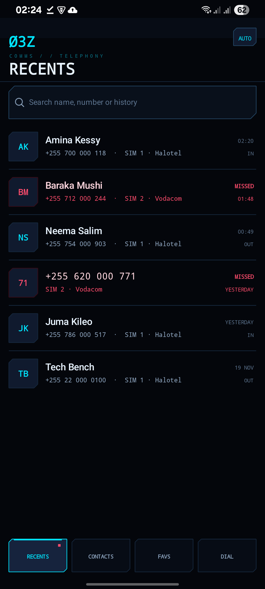
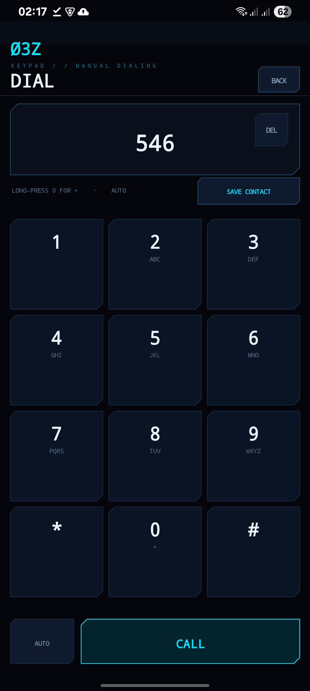
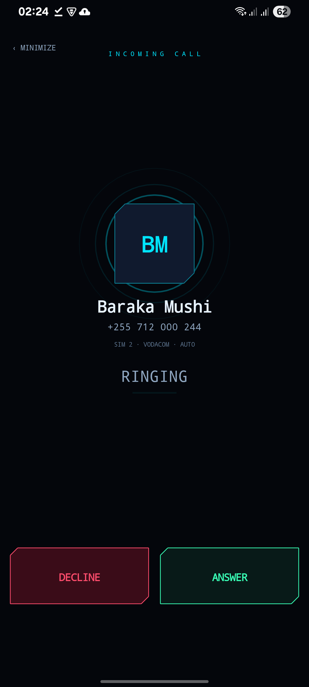
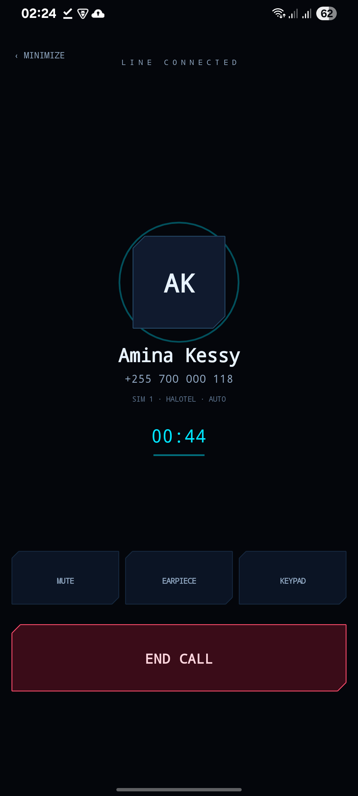
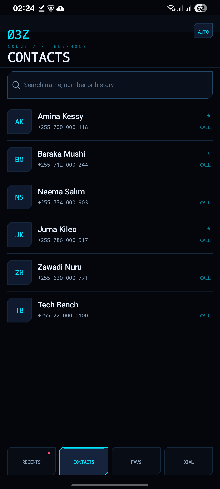
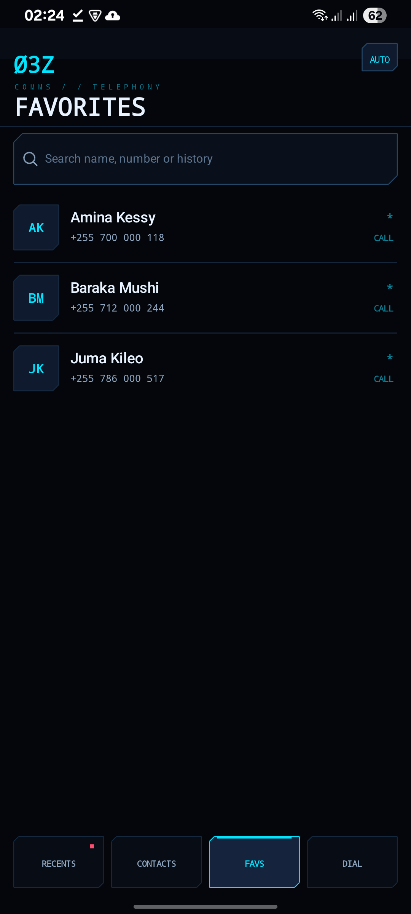
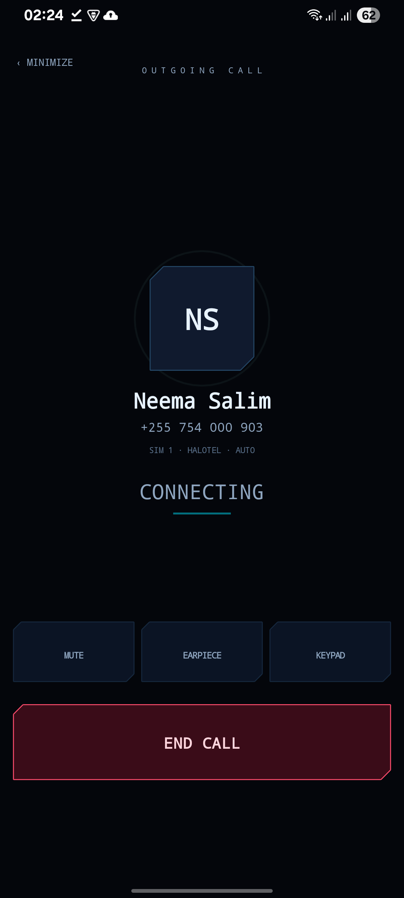

# E.I.S Dialer — Releases

Public download repository for signed **E.I.S Dialer** APKs.

- Latest APK: see [Releases](../../releases/latest)

## Screenshots

| Recents | Keypad | Incoming |
| --- | --- | --- |
|  |  |  |
| **Active call** | **Contacts** | **Favorites** |
|  |  |  |
| **Outgoing** | | |
|  | | |

Each release carries the signed APK for that version, tagged with the app's
version number (for example `v1.2.0`). Compare the SHA-256 shown in the release
notes with the file you downloaded.

E.I.S Dialer is proprietary software, licensed All Rights Reserved.
Copying, modification, redistribution or commercial use requires written
permission from E.I.S.

## License

Proprietary — All Rights Reserved. See [LICENSE](LICENSE). The APK may be
downloaded and installed for personal use on your own devices; copying,
modifying, redistributing or commercially using the app, its screenshots or
its code requires written permission from E.I.S.
